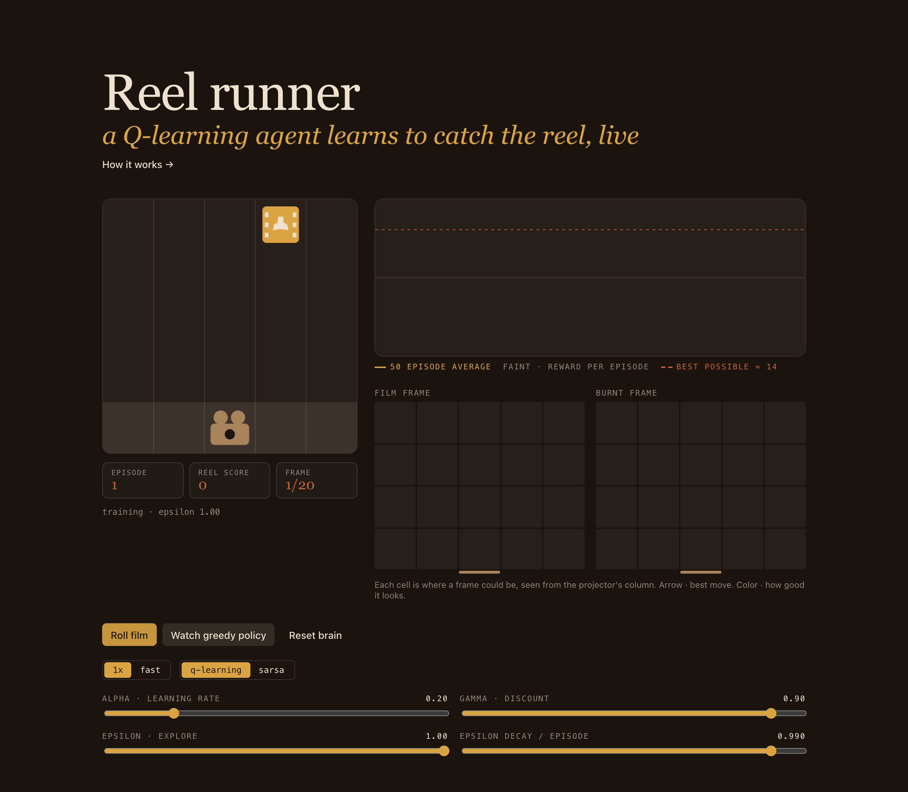
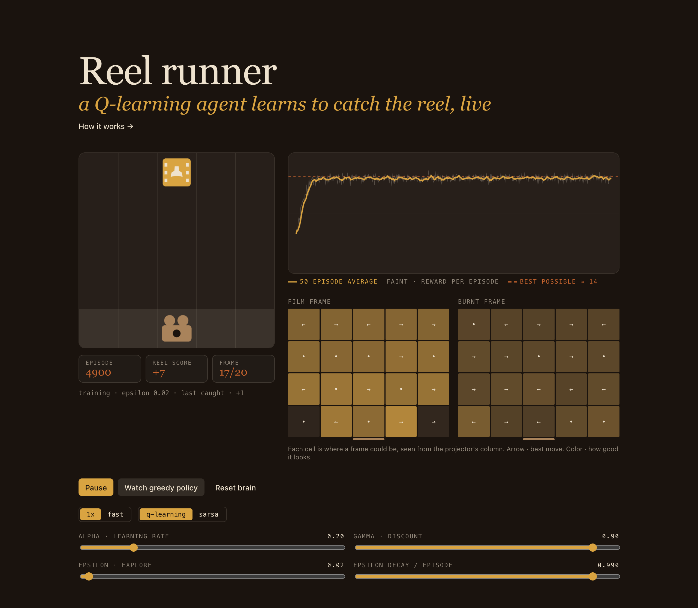

# Reel Runner

Tabular Q-learning and SARSA written from scratch: an agent learns to catch film frames and dodge burnt ones, live in your browser.





**Live demo:** [worksofabhiram.live/machine-learning-lab/reel-runner](https://worksofabhiram.live/machine-learning-lab/reel-runner)

## What it is

A tiny game and a tiny reinforcement learning agent, both in plain TypeScript with no ML libraries and no neural network, just a table of 600 numbers. Frames fall down a five column lane. A projector at the bottom moves left, stays, or moves right to catch the good film frames and avoid the burnt ones. The agent starts out moving at random and improves while you watch.

The page shows:

- **The game**, with the current episode, reel score and frame.
- **A reward chart**: reward per episode (faint), a 50 episode moving average, and the best possible score as a dashed line.
- **A Q heatmap**: for every place a frame could be, seen from the projector's current column, the best move (arrow) and how good the table thinks it is (color). One grid for film frames, one for burnt frames.
- **Controls**: pause or roll, watch the greedy policy (epsilon 0, learning off), reset the brain, normal or fast speed, Q-learning or SARSA, and sliders for alpha, gamma, epsilon and epsilon decay.

## How it works

### The environment

A lane five columns wide and five rows tall. One frame falls at a time, one row per step. 70% are film frames, 30% are burnt. A projector sits on the bottom row and moves left, stays, or moves right. A reel is 20 frames, so 80 steps.

**State**: projector column (5) × frame column (5) × frame row (4) × film or burnt (2) = 200 states.
**Actions**: left, stay, right. Moving into a wall leaves the projector where it is.

**Rewards** arrive only when a frame lands. Catch film +1, miss film −1, catch a burnt frame −1, dodge it 0. Every frame can be reached in time, so a perfect reel scores the number of film frames, about 14.

### The Bellman update

After every step the agent nudges one table entry toward a better estimate.

```
Q(s, a) ← Q(s, a) + α · [ r + γ · max_a′ Q(s′, a′) − Q(s, a) ]
```

_s_ is the state, _a_ the move taken, _r_ the reward, _s′_ the next state. The bracket is the error between what the agent expected and what it now believes. When a reel ends the target is just _r_, since nothing comes after.

### Q-learning vs SARSA

The only difference is the lookahead term.

```
Q-learning · target = r + γ · max_a′ Q(s′, a′)
SARSA      · target = r + γ · Q(s′, a′_taken)
```

Q-learning is off-policy. It learns the value of playing greedily, even while it explores. SARSA is on-policy. It learns the value of the exploring policy it actually follows, random moves included.

Measured here, Q-learning's greedy policy got good in about half the episodes SARSA needed, while SARSA scored slightly higher during training. Learning the policy it really runs makes it a little more careful.

### Exploration schedule

Epsilon-greedy. With probability ε the agent moves at random, otherwise it takes the best move in its table, breaking ties at random. ε starts at 1 and is multiplied by the decay after each reel, with a floor of 0.02. "Watch greedy policy" sets ε to 0 and pauses learning, so you see only what the table knows.

### Hyperparameters

| knob    | default          | what it does                                                      |
| ------- | ---------------- | ----------------------------------------------------------------- |
| alpha   | 0.2              | Step size. How far each update moves Q toward its target.         |
| gamma   | 0.9              | Discount. How much a reward four steps away is worth now.         |
| epsilon | 1.0 → 0.02       | Chance of a random move. Starts fully random.                     |
| decay   | 0.99 per episode | Epsilon is multiplied by this after every reel, never below 0.02. |

### Results

Measured by running the same code in Node, 20 seeds × 1,500 episodes, default knobs. The greedy checks freeze the table and play 100 reels with ε = 0.

| what                                                                  | value                   | how                       |
| --------------------------------------------------------------------- | ----------------------- | ------------------------- |
| Random policy, average reward per episode                             | −9.55                   | 5,000 episodes            |
| Trained greedy policy, average reward per episode                     | 13.97                   | 500 episodes × 20 seeds   |
| Best possible (expected film frames per reel)                         | 14.0                    | 20 frames × 70% film      |
| Episodes until the frozen greedy policy averages 13+, Q-learning      | median 30 (20 to 30)    | checked every 10 episodes |
| Same, SARSA                                                           | median 60 (50 to 90)    | checked every 10 episodes |
| Episodes until the 50 episode training average reaches 12, Q-learning | median 304 (249 to 340) | with exploration on       |
| Same, SARSA                                                           | median 282 (243 to 307) | with exploration on       |
| Training average over the last 100 episodes, Q-learning vs SARSA      | 13.34 vs 13.50          | epsilon at its 0.02 floor |

The gap between the two kinds of numbers is the point. The table knows a near perfect policy after about 30 reels, but the training curve only crosses 12 once ε has decayed enough to stop throwing reels away.

### Failure modes

**No discount.** With γ = 0 the agent only learns from the single step right before a frame lands. Earlier moves all look worth zero, so it wanders. Measured greedy score: 0.59 per reel, against 13.97 with γ = 0.9.

**Too slow decay.** At 0.999 per reel, ε is still about 0.22 after 1,500 episodes. The greedy policy is already perfect, yet the training average sits at 7.17 and never reaches 12.

**Too fast decay.** The usual risk is locking in a bad habit before the agent has seen enough. Here it did not bite. At 0.9 per reel the training average reached 12 in a median of 64 episodes, and even ε = 0 from the start got there in 54. Starting the table at zero, when most outcomes cost −1, makes untried moves look better than tried ones, so the agent explores on its own. A bigger world or a positive reward per step would remove that safety net.

**Reward shaping.** Extra rewards meant to help can redefine the task. A bonus for standing under the falling frame would pay the agent to hug burnt frames too, and a penalty per move would teach it to stay put and accept misses. Not measured here, kept as a design rule: reward the outcome, not the path.

### Limitations

A table only works because there are 200 states. A wider lane, several frames at once, or speed changes would blow it up, and that is where function approximation, like a small neural network, takes over. The world is fully observable and its only randomness is where frames spawn, which keeps learning fast and makes the results look easier than real control problems. Everything runs on the main thread in short slices per animation frame, so fast-forward speed depends on the device.

## Run locally

Requires Node 20 or newer.

```sh
npm install
npm run dev       # dev server
npm run build     # type check and production build into dist/
npm run preview   # serve the production build
```

## Project structure

```
src/
  brain/                 pure learning code, no React
    lane.ts              environment: state encoding, rewards, step function
    agent.ts             Q table, epsilon-greedy choice, Q-learning and SARSA update
    episode.ts           runs one step or a whole episode, epsilon decay
    rng.ts               small seeded random number generator
  demo/
    ReelRunner.tsx       page layout and readouts
    Controls.tsx         buttons, toggles and hyperparameter sliders
    useTrainer.ts        animation loop that trains the agent in time slices
  screens/
    GameCanvas.tsx       canvas drawing of the lane, frame and projector
    RewardChart.tsx      canvas reward chart with moving average
    PolicyHeatmap.tsx    Q table heatmap with best move arrows
  usePaletteColors.ts    reads theme CSS variables for canvas drawing
  theme.css              color tokens, dark by default, light via prefers-color-scheme
  styles.css             layout and component styles
  main.tsx               entry point
```

## License

[MIT](LICENSE) © 2026 Abhiram Shaji
